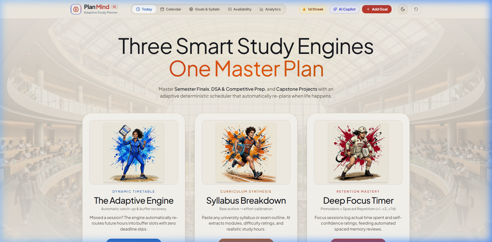
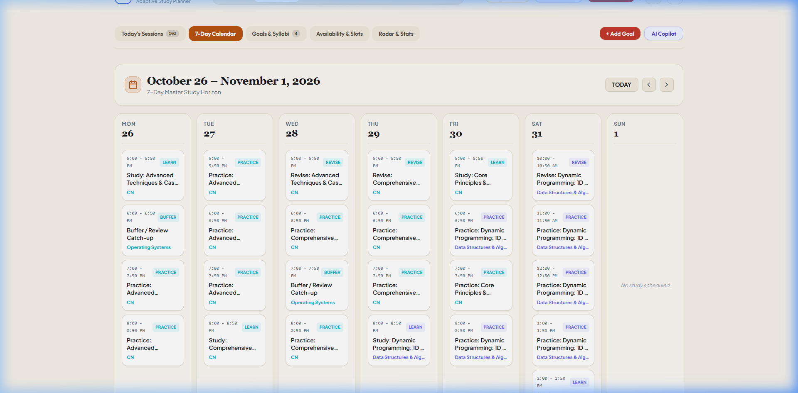

# PlanMind AI

> **Adaptive College Study Planner & Deterministic Timetable Engine**

PlanMind AI is an intelligent study management system designed for university students, competitive exam aspirants, and software engineering candidates. 

Unlike static calendar apps that break the moment a session is missed, PlanMind combines **deterministic heuristic scheduling**, **automated buffer recovery**, and **LLM curriculum synthesis** to keep study targets on track when unexpected life events occur.

---

## Visual Preview & Demos

### 1. Interactive Study Engines & Ambient Workspace
The landing interface provides immediate access to dynamic timetables, AI syllabus breakdown, and deep focus timers over a translucent university atrium backdrop.



### 2. 7-Day Master Calendar & Task Checkboxes
A multi-day horizon displaying interleaved study blocks, difficulty indicators, and direct in-calendar completion toggles.



---

## Why PlanMind?

Traditional planners suffer from the **"cascade failure problem"**: missing one session throws off every subsequent day, leading to schedule abandonment.

PlanMind solves this with an **adaptive feedback loop**:

1. **Curriculum Synthesis:** Paste raw course syllabi or exam outlines. The engine extracts individual modules, difficulty ratings (1–5), and realistic hour allocations.
2. **Deterministic Scheduling:** Sessions are allocated across weekly availability windows using energy-curve matching and subject interleaving to maximize retention.
3. **Automated Buffer Recovery:** 15–20% of study availability is automatically reserved as dynamic buffer slots.
4. **1-Click Adaptive Re-Planning:** If a session is missed or delayed, clicking **Re-Plan** recalculates future allocations into open buffer hours with zero deadline slips and zero guilt.

---

## Core Capabilities

| Feature | Description |
| :--- | :--- |
| **Interactive Task Checkboxes** | 1-click status toggling directly on task cards. Instantly switch between `Completed` and `To Do` with optimistic UI updates. |
| **AI Syllabus Breakdown** | Ingests university syllabus outlines and outputs difficulty-calibrated study topics with realistic completion targets. |
| **Adaptive Buffer Engine** | Automatically detects missed or adjusted blocks and safely routes pending hours into reserved buffer slots. |
| **Interactive App Guide** | Embedded 4-step onboarding workflow and navigation map accessible directly from the header and hero. |
| **Spaced Revision Scheduling** | Automatically inserts $+1$, $+3$, and $+7$-day retention review blocks following high-difficulty learn sessions. |
| **Pomodoro Focus Timer** | Built-in 25/50-minute focus session timer with confidence ratings and actual-duration logging. |
| **Dark / Light Theme** | Custom high-contrast dark mode and warm parchment arcade light palette. |

---

## Monorepo Architecture

PlanMind is architected as an npm workspaces monorepo:

```
AI-studyPlanner/
├── apps/
│   ├── api/                  # Express REST backend
│   │   ├── src/
│   │   │   ├── routes/       # API endpoints (goals, sessions, availability, plan)
│   │   │   ├── services/     # In-memory store, AI mock/live fallback, seed generator
│   │   │   └── server.ts     # Server bootstrap & CORS configuration
│   │   └── package.json
│   │
│   └── web/                  # React 18 + Vite frontend
│       ├── src/
│       │   ├── components/   # ArcadeHero, AppGuideModal, FocusTimer, ReplanDiff
│       │   ├── pages/        # TodayView, WeekCalendarView, GoalsView, AvailabilityView
│       │   ├── api/          # Typed API client wrapper
│       │   └── App.tsx       # Root workspace orchestration
│       └── package.json
│
├── packages/
│   ├── shared/               # Shared domain models & Zod validation schemas
│   │   └── src/              # Session, Goal, Topic, AvailabilitySlot, ReplanDiff
│   │
│   └── scheduler/            # Deterministic scheduling algorithms
│       ├── src/
│       │   ├── engine.ts     # Slot matching, priority scoring, interleaving logic
│       │   ├── replanner.ts  # Buffer recovery & plan diff calculation
│       │   └── scorer.ts     # Subject balance & energy profile scoring
│       └── test/             # Unit tests for scheduling feasibility & re-planning
│
├── docs/
│   └── demo/                 # Screenshots & walkthrough media
├── package.json              # Monorepo root configuration & scripts
└── tsconfig.base.json        # Base TypeScript compiler options
```

---

## Quick Start & Local Setup

### Prerequisites
- **Node.js** $\ge 18.0.0$
- **npm** $\ge 9.0.0$

### 1. Clone the Repository
```bash
git clone https://github.com/PrakharJain345/StudyPlanner.git
cd StudyPlanner
```

### 2. Install All Dependencies
```bash
npm install
```

### 3. Run Development Servers
Start both the backend API server (`localhost:3001`) and the Vite web client (`localhost:5173`) concurrently:
```bash
npm run dev
```

Alternatively, run each service individually:
```bash
# Terminal 1: Express API Server
npm run dev:api

# Terminal 2: Vite Web Client
npm run dev:web
```

Open [http://localhost:5173](http://localhost:5173) in your browser.

### 4. Run Test Suite
Validate the deterministic scheduler engine and buffer re-planning rules:
```bash
npm test
```

---

## Demo Mode

PlanMind includes pre-seeded demo data for instant evaluation without manual setup:

1. Open the application at [http://localhost:5173](http://localhost:5173).
2. The demo automatically initializes a **Computer Science Semester** with active courses:
   - *Data Structures & Algorithms* (Exam in 21 days)
   - *Operating Systems* (Exam in 35 days)
   - *Computer Networks* (Exam in 42 days)
3. Try checking off a task in **Today's Sessions** or clicking **Skip** on an upcoming session to observe the **Adaptive Re-Plan** recommendation in real time.
4. Click the **Reset Demo** icon ($\circlearrowleft$) in the top navigation bar at any point to restore the sample dataset.

---

## REST API Overview

| Method | Endpoint | Description |
| :--- | :--- | :--- |
| `POST` | `/api/auth/demo` | Authenticates demo session with pre-seeded sample data |
| `GET` | `/api/goals` | Retrieves all registered goals with topic counts |
| `POST` | `/api/goals/breakdown` | AI syllabus parser: converts outlines into structured topics |
| `GET` | `/api/sessions` | Fetches study sessions filtered by date range |
| `PATCH`| `/api/sessions/:id` | Updates session status (`done`, `pending`, `skipped`) |
| `GET` | `/api/availability` | Retrieves weekly study time slot allocations |
| `POST` | `/api/plan/replan` | Triggers deterministic recalculation and returns plan diff |
| `POST` | `/api/plan/apply` | Commits recalculated session allocations to storage |
| `GET` | `/api/dashboard/summary`| Returns weekly completion velocity, streak, and radar metrics |

---

## Production Deployment

PlanMind AI supports both unified fullstack hosting (single service) and decoupled edge hosting.

### Option 1: Unified Service (Render / Railway / Fly.io) — *Recommended*

The Express backend automatically serves the production-compiled Vite client from `apps/web/dist`, allowing you to run the entire application on a single free or low-cost container.

1. Connect your GitHub repository to [Render](https://render.com) or [Railway](https://railway.app).
2. Configure a **Web Service**:
   - **Environment:** `Node`
   - **Build Command:** `npm install --include=dev && npm run build`
   - **Start Command:** `npm start`
   - **Health Check Path:** `/health`
3. Add Environment Variables:
   - `NODE_ENV`: `production`
   - `PORT`: `10000` (Render default) or `3001`
   - *(Optional)* `MONGODB_URI`: Connect to MongoDB Atlas (defaults to persistent local/hybrid storage if omitted).

A ready-to-use [`render.yaml`](render.yaml) blueprint is included in the root directory for automated setup.

---

### Option 2: Decoupled Hosting (Vercel Frontend + Render Backend)

If you prefer deploying the React frontend to Vercel's global CDN:

1. **Deploy Backend API:**
   - Deploy the monorepo root to Render/Railway following Option 1.
   - Note your live API URL (e.g., `https://planmind-api.onrender.com`).

2. **Deploy Frontend on Vercel:**
   - Import the repository into [Vercel](https://vercel.com).
   - Set **Root Directory** to `apps/web`.
   - Add Environment Variable:
     - `VITE_API_URL`: `https://planmind-api.onrender.com`
   - Client-side routing is automatically handled via [`apps/web/vercel.json`](apps/web/vercel.json).

---

### Option 3: Docker Container

Deploy anywhere supporting OCI containers:

```bash
# Build the production image
docker build -t planmind-ai .

# Run the container
docker run -p 3001:3001 -e NODE_ENV=production planmind-ai
```

Access the application at `http://localhost:3001`.

---

## Tech Stack

- **Frontend:** React 18, Vite, Tailwind CSS, Lucide Icons, Date-fns
- **Backend:** Node.js, Express, TypeScript, in-memory state store with JSON persistence
- **Domain & Validation:** Zod schemas shared across client, server, and scheduler
- **Scheduling Engine:** Custom deterministic constraint solver with buffer optimization
- **Monorepo Tooling:** npm workspaces, TypeScript Project References

---

## License

This project is licensed under the [MIT License](LICENSE).
